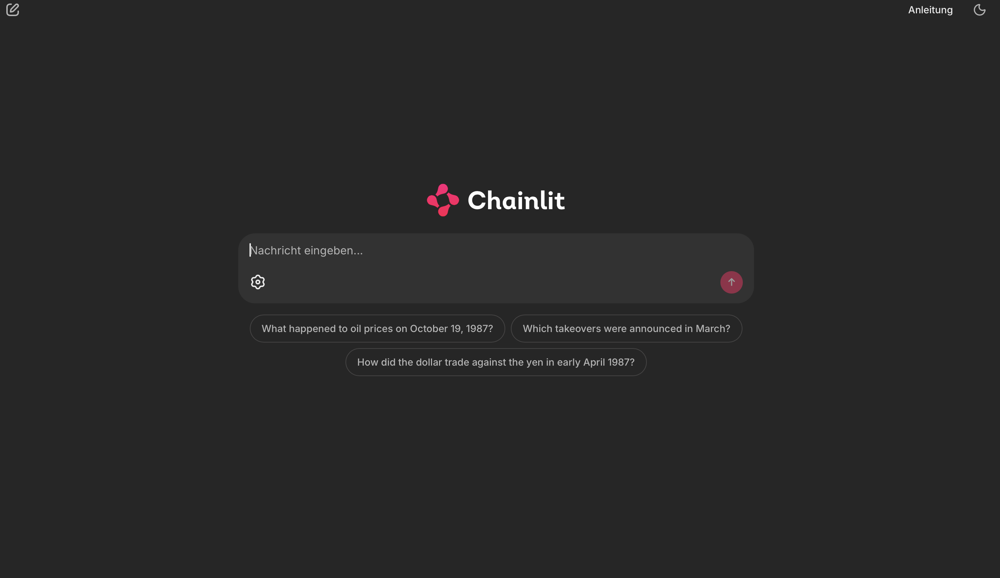
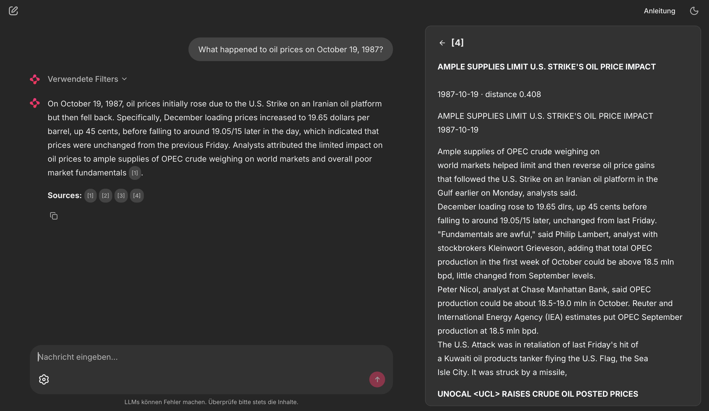
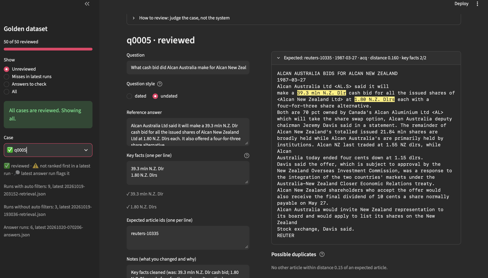
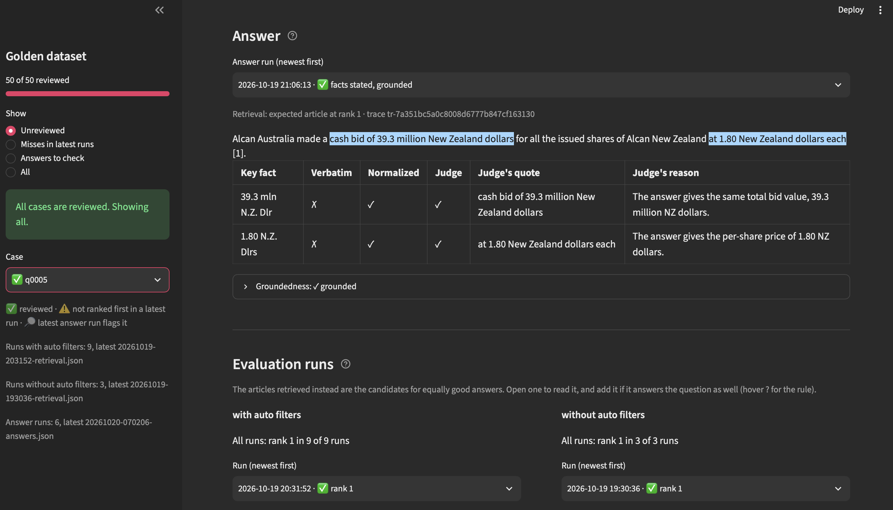

# FastAPI RAG Boilerplate

[](https://github.com/fischerdm/fastapi-rag-boilerplate/actions/workflows/ci.yml)
[](https://fastapi-rag-boilerplate.streamlit.app/)

[](LICENSE)
[](https://github.com/astral-sh/ruff)

<p align="center">
  
  
</p>

A minimal RAG backend: index text over an API, then ask questions and get a streamed answer grounded in the indexed documents.

- **API:** FastAPI
- **Embeddings / LLM:** OpenAI (`text-embedding-3-small`, `gpt-4o-mini` by default)
- **Vector store:** Chroma (persisted locally in `data/chroma`)
- **Chat UI:** Chainlit, served at `/ui`

How it works, component by component: [docs/architecture.md](docs/architecture.md). How it is evaluated: [docs/evaluation.md](docs/evaluation.md). Setting up the Databricks workspace it is moving to: [docs/databricks-setup.md](docs/databricks-setup.md).

## Setup

Python 3.12, the version of current Databricks Runtimes.

```bash
python3.12 -m venv .venv
.venv/bin/pip install -r requirements.txt
cp .env.example .env   # then set OPENAI_API_KEY
.venv/bin/uvicorn app.main:app --reload
```

Interactive docs: http://127.0.0.1:8000/docs · Chat UI: http://127.0.0.1:8000/ui

For development (review UI, linter):

```bash
.venv/bin/pip install -r requirements-dev.txt
.venv/bin/ruff check .   # rules in pyproject.toml; --fix applies the safe fixes
.venv/bin/ruff format .  # formatting
```

## Chat UI

[app/ui.py](app/ui.py) is a [Chainlit](https://docs.chainlit.io) app mounted into the API at `/ui`. It is a plain client of `/query`: it posts the question over HTTP and renders the SSE stream.

- **Filters** appear as a collapsible step above each answer, showing what was actually applied (`filters` event).
- **Sources** open in a side panel; the citation markers `[1]`, `[2]`, … in the answer link to them (`sources` event).
- **Settings** (gear icon next to the input) set an explicit date range, topic and number of passages, or switch off automatic filter extraction.

The UI reaches the API at `API_URL` (default `http://127.0.0.1:8000`); set it if you serve the API on another port. Chainlit's own settings (name, file upload, theme) live in [.chainlit/config.toml](.chainlit/config.toml).

To run the UI as a separate process instead, start both from the repo root, each in its own terminal, then open http://localhost:8001:

| Terminal | Command | Port |
|---|---|---|
| 1: API | `.venv/bin/uvicorn app.main:app --reload` | 8000 |
| 2: UI | `.venv/bin/python -m chainlit run app/ui.py --port 8001` | 8001 |

Keep the `--port`: Chainlit also defaults to port 8000, and without it the UI would send its queries to itself.

## Corpus: Reuters-21578

[Reuters-21578](https://archive.ics.uci.edu/dataset/137/reuters+21578+text+categorization+collection) is a classic collection of Reuters business and financial newswire articles from Feb–Oct 1987. The ingest script downloads it into `data/reuters21578/` and indexes the ~19k articles that have a body:

```bash
.venv/bin/python -m scripts.ingest_reuters --limit 500   # quick sample
.venv/bin/python -m scripts.ingest_reuters               # full corpus
```

Each chunk carries `title`, `date`, `date_int` (e.g. `19870315`, for range filters), `topics` and `places` (lists of Reuters codes) as metadata. Re-running the script updates existing entries instead of duplicating them.

To refresh metadata on an existing index without re-embedding (e.g. after a metadata format change), run `python -m scripts.ingest_reuters --metadata-only`.

## Evaluation: golden dataset

A golden dataset is a fixed, reviewed set of questions with known right answers ([evals/golden.jsonl](evals/golden.jsonl)). Running it after every change to prompts, models, chunking or `top_k` shows whether retrieval and answers got better or worse. The approach, the metrics and the findings so far are explained in [docs/evaluation.md](docs/evaluation.md).

```bash
.venv/bin/python -m evals.generate --n 50             # draft cases from corpus articles
.venv/bin/streamlit run evals/review_app.py           # review them (pip install -r requirements-dev.txt)
.venv/bin/python -m evals.checks                      # check all cases against the dataset rules
.venv/bin/python -m evals.evaluate                    # score retrieval as /query runs it
.venv/bin/python -m evals.evaluate --no-auto-filters  # compare: plain similarity search
.venv/bin/python -m evals.score_answers               # score answers with MLflow (needs ANTHROPIC_API_KEY)
```

| Metric | Meaning |
|---|---|
| `hit@1`, `hit@k` | Share of questions where the expected article is ranked first / retrieved at all |
| `MRR` | Mean of 1/rank of the expected article; 0 if not retrieved |
| `filt.out` | Share of questions where the inferred filters excluded the expected article before the search |
| key facts: verbatim / normalized / judge | Share of answers containing every key fact: verbatim (free), verbatim after writing abbreviations one way (free), or per a Claude judge that quotes its evidence |
| grounded | Share of answers whose every claim is supported by the retrieved passages (MLflow's built-in judge) |

**Findings so far:** filtering by the inferred topic hurt retrieval (hit@4 86% on average over five runs), because a wrong topic removes the right article and the fallback only runs on zero results. Using only the inferred dates gives 94%, stable across runs, so the topic is no longer applied by default (`TOPIC_MODE=off`). A topic boost instead of a filter showed no reliable gain. Answers contain every key fact in about 93% of cases (99% when the right article is retrieved) and are grounded in 99%; the remaining failures are retrieval misses. Details in [docs/evaluation.md](docs/evaluation.md#6-findings).

**Not implemented yet:** a chunk-level retrieval check. hit@k counts an article as found when any of its chunks is retrieved, even if the chunk holding the answer is not (q0021). Checking whether each key fact appears in the retrieved chunks would catch that for free, like the normalized fact check; DeepEval's contextual recall (usable through MLflow) is the LLM-judged version of the same idea. Note that it measures retrieval, not the answer, so it complements groundedness rather than replacing it.

### Review app

**Live demo (read-only): [fastapi-rag-boilerplate.streamlit.app](https://fastapi-rag-boilerplate.streamlit.app/)**

<p align="center">
  
  
</p>

Generated cases are drafts; every one of the 50 was reviewed by hand in [evals/review_app.py](evals/review_app.py), a Streamlit app built for that job. It shows one case at a time, with the editable fields next to the full text of the expected articles, and saves straight back to `golden.jsonl`, so `git diff` shows what the review changed.

- **Rules checked as you edit:** each key fact gets ✓ or ✗ for appearing verbatim in every expected article and for adding something beyond the question, and is highlighted in the articles. Saving runs the full rule set of `evals.checks`, including the question's dated/undated style.
- **Possible duplicates:** Reuters often ran a story twice. Articles close to an expected one are listed with the key facts they lack, so a reviewer can add a true duplicate to `expected_doc_ids` instead of counting it as a miss.
- **Driven by the evaluation runs:** 'Misses in latest runs' shows the cases where retrieval did not rank an expected article first, with the articles it retrieved instead, each one click away from `expected_doc_ids`. 'Answers to check' shows the cases where the free fact checks and the judge disagree; the answer is shown with the verbatim matches in yellow and the judge's quotes in blue, next to the groundedness verdict.

**Read-only demo.** The app can also run without the vector index or an API key, as on [Streamlit Community Cloud](https://streamlit.io/cloud): with `REVIEW_DEMO=1`, editing is disabled and the distances, duplicate candidates and evaluation runs come from a snapshot in [evals/demo/](evals/demo/). To refresh the snapshot after changing cases or adding runs, run `.venv/bin/python -m evals.build_demo` locally and commit `evals/demo/`. To deploy, create an app from this repository with main file `evals/review_app.py` and the secret `REVIEW_DEMO = "1"`. Streamlit Cloud then installs only [evals/requirements.txt](evals/requirements.txt), and the theme in [.streamlit/config.toml](.streamlit/config.toml) matches the chat UI.

## Endpoints

| Method | Path      | Description                                                        |
|--------|-----------|--------------------------------------------------------------------|
| GET    | `/health` | Liveness check                                                     |
| POST   | `/index`  | Queue a document for chunking + embedding; returns `202` and an id |
| POST   | `/query`  | Retrieve the top-k chunks and stream the answer as SSE             |

```bash
curl -X POST localhost:8000/index -H 'Content-Type: application/json' \
  -d '{"content": "ECB holds rates steady...", "metadata": {"source": "example"}}'

curl -N -X POST localhost:8000/query -H 'Content-Type: application/json' \
  -d '{"question": "What did the ECB decide?"}'
```

`/query` accepts optional filters that restrict the search before ranking by similarity:

```bash
curl -N -X POST localhost:8000/query -H 'Content-Type: application/json' \
  -d '{"question": "What happened to oil prices?", "date_from": "1987-10-19", "date_to": "1987-10-20", "topic": "crude"}'
```

`topic` is a Reuters topic code such as `crude`, `acq` (acquisitions), `earn` (earnings) or `money-fx`; the codes that occur in the corpus are listed in [app/topics.py](app/topics.py).

### Automatic filters

By default (`"auto_filters": true`) an LLM (`FILTER_MODEL`, default `gpt-5.4-nano`) reads the question first and fills in missing filters, using OpenAI structured outputs with a Pydantic model as the response format:

| Question | Extracted filters |
|---|---|
| What happened to oil prices on October 19, 1987? | 1987-10-19 – 1987-10-20, `crude` |
| Which takeovers were announced in March? | 1987-03-01 – 1987-03-31, `acq` |
| How did the dollar trade against the yen in early April 1987? | 1987-04-01 – 1987-04-10, `money-fx` |

- Explicit filters in the request always win; dates are taken as a pair.
- A single extracted day is widened by one day, since news about an event often runs the day after.
- If the extraction fails, or its filters match nothing, the search falls back to the explicit filters only.

`/query` emits four event types: `filters` (the filters actually applied, once), `sources` (the retrieved chunks, once), `token` (JSON-encoded text pieces), and `done`.

## Towards production

This is a boilerplate: it runs well on one machine for one user. Before exposing it to real traffic, these are the main gaps:

- **Authentication and rate limiting.** `/index` and `/query` are open, so anyone who reaches the API can write to the index and may add junk or misleading documents. One request is enough to put a fake article into the corpus:

  ```bash
  curl -X POST localhost:8000/index -H 'Content-Type: application/json' \
    -d '{"content": "Reuters, March 1987: OPEC agreed to double oil output...", "metadata": {"topics": ["crude"], "date_int": 19870315}}'
  ```

  After that, a question about oil in March 1987 can retrieve this text and cite it as a source, next to the real articles. Nothing records who added it. Every request also triggers OpenAI calls billed to the server's API key. Add API keys or OAuth (a FastAPI dependency), per-client rate limits, and a size limit on `/index` content.
- **Durable indexing.** `BackgroundTasks` runs in the API process: a queued document is lost on restart, and the returned `document_id` cannot be looked up. Move indexing to a job queue (e.g. Arq, Celery, RQ) and add a status endpoint, plus endpoints to update and delete documents.
- **A shared vector store.** Chroma runs embedded on local files, which ties the API to one process on one machine. Run Chroma in client/server mode or switch to a managed store (pgvector, Qdrant, …) so several workers or replicas can share the index.
- **Resilience around OpenAI.** Set timeouts and retries with backoff, and send an `error` event on the SSE stream when generation fails midway, so clients can tell a broken answer from a finished one.
- **Deployment.** A Dockerfile, no `--reload`, several workers, and a reverse proxy configured not to buffer SSE responses. Pin dependency versions with a lock file; `requirements.txt` only sets lower bounds.
- **Observability.** Structured logs, request metrics, and traces of each step (filter extraction, retrieval, generation) with token usage and cost. `/health` is a liveness check only; add a readiness check that reaches the vector store.
- **Tests and evaluation.** Unit and API tests in CI. The [golden dataset](#evaluation-golden-dataset) scores retrieval and answers; refusals on unanswerable questions are not tested yet. Run the evaluation in CI and fail on drops in its scores.
- **Security of the content itself.** Indexed documents end up in the prompt, so untrusted documents can carry prompt injections. Restrict who can index, and treat answers as untrusted output.

### Why FastAPI

FastAPI fits this workload well, and it does help in production, though it covers only the API layer of the list above:

- **Async by design.** A RAG request mostly waits on network calls (embeddings, LLM). On an ASGI server one process serves many such requests concurrently, and streaming the answer over SSE is a plain `StreamingResponse`. Blocking calls such as Chroma's are moved to a thread pool.
- **Typed contracts.** Pydantic models validate every request and response (e.g. `top_k` between 1 and 20, `date_from` not after `date_to`), and the same models generate the OpenAPI docs at `/docs`.
- **Dependency injection.** Authentication, rate limiting, and per-request clients plug in as dependencies without touching endpoint code.
- **ASGI ecosystem.** Other ASGI apps mount into the same server, as Chainlit does at `/ui`, and standard middleware (CORS, OpenTelemetry, Prometheus) works out of the box.

## License

[MIT](LICENSE)
