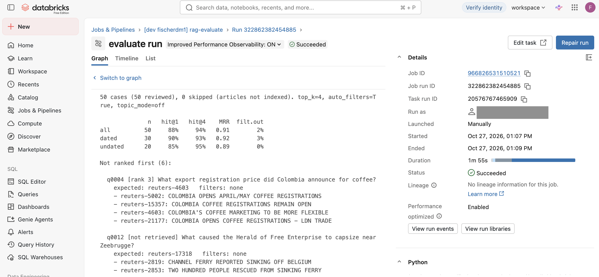

# Databricks RAG

[](https://github.com/fischerdm/databricks-rag/actions/workflows/ci.yml)
[](https://github.com/fischerdm/databricks-rag/actions/workflows/evaluate.yml)

[](LICENSE)
[](https://github.com/astral-sh/ruff)

<p align="center">
  
  
</p>

A RAG chatbot over the Reuters-21578 newswire corpus (business news, 1987), running on Databricks Free Edition: a FastAPI backend and a Chainlit chat UI as a Databricks App, Databricks Vector Search as the index, and a golden-dataset evaluation that runs as a pull request check.

It started as a fork of [fastapi-rag-boilerplate](https://github.com/fischerdm/fastapi-rag-boilerplate), which runs the same app on one machine with Chroma. Everything from there still works locally; the Databricks parts are added alongside it.

| Document | Contents |
|---|---|
| [docs/databricks-setup.md](docs/databricks-setup.md) | How the workspace was set up, step by step, and how to deploy and run everything |
| [docs/architecture.md](docs/architecture.md) | How the app works, component by component, including the API endpoints |
| [docs/evaluation.md](docs/evaluation.md) | The golden dataset, the metrics and the findings |
| [docs/evaluation-in-ci.md](docs/evaluation-in-ci.md) | How the evaluation works as a CI gate |

## Models

| Step | Model | Provider | Setting |
|---|---|---|---|
| Embeddings (chunks and questions) | `text-embedding-3-small` | OpenAI | `EMBEDDING_MODEL` |
| Filter extraction (dates, topic from the question) | `gpt-5.4-nano` | OpenAI | `FILTER_MODEL` |
| Answers | `gpt-4o-mini` | OpenAI | `CHAT_MODEL` |
| Evaluation judges (key facts, groundedness) | `claude-sonnet-5-5` | Anthropic | `JUDGE_MODEL` |

The judges come from a different provider than the answers, so answers are not graded by a model of the same family. The app calls OpenAI from Databricks; the Databricks Foundation Models available in the workspace are a planned later step. That step will be measured on its own, because changing the vector store and the models at the same time would make a drop in the scores impossible to attribute.

## Setup on Databricks

The full walkthrough is in [docs/databricks-setup.md](docs/databricks-setup.md). In short:

| Object | Name | Created by |
|---|---|---|
| Schema | `workspace.rag` | CLI, once |
| Volume holding the raw archive | `workspace.rag.raw` | CLI, once (serverless compute cannot reach the UCI archive, so it is uploaded from a local machine) |
| Secret scope | `rag`, with `openai_api_key` and `anthropic_api_key` | CLI, once |
| Chunk table | `workspace.rag.chunks` (28,261 chunks with OpenAI embeddings) | Job `rag-ingest-chunks` |
| Vector Search endpoint and index | `rag`, `workspace.rag.chunks_index` (Delta Sync, triggered) | Bundle |
| App | `rag-chat` (FastAPI + Chainlit) | Bundle |
| Evaluation job and MLflow experiment | `rag-evaluate`, `rag-evals` | Bundle |
| CI service principal | `rag-ci` | CLI, once; its credentials are GitHub secrets |

Everything except the one-time objects is defined in the Asset Bundle [databricks.yml](databricks.yml). It has two targets: `dev` (the default) deploys everything as your user, and `ci` deploys only the evaluation job, so a pull request cannot change the shared index or the app.

## Running the app

### On Databricks

After the one-time setup:

```bash
databricks bundle deploy                       # create or update jobs, index, app
databricks bundle run ingest_chunks            # build the chunk table (about 5 min)
databricks vector-search-indexes sync-index workspace.rag.chunks_index
databricks bundle run rag_chat                 # upload the code and (re)start the app
```

The app's URL is printed at the end and shown under **Compute** → **Apps**. Opening it requires a Databricks login. A running app uses compute; stop it with `databricks apps stop rag-chat`.

### Locally

Python 3.12, the version of current Databricks Runtimes.

```bash
python3.12 -m venv .venv
.venv/bin/pip install -r requirements.txt
cp .env.example .env   # then set OPENAI_API_KEY (and ANTHROPIC_API_KEY for the judges)
.venv/bin/uvicorn app.main:app --reload
```

Chat UI: http://127.0.0.1:8000/ui · API docs: http://127.0.0.1:8000/docs

The local app searches Chroma by default, which needs a local index (`.venv/bin/python -m scripts.ingest_reuters`, add `--limit 500` for a sample). Set `VECTOR_BACKEND=databricks` in `.env` to search the Vector Search index instead; the Databricks SDK then authenticates with your CLI profile.

For development (linter, review app):

```bash
.venv/bin/pip install -r requirements-dev.txt
.venv/bin/ruff check .
.venv/bin/ruff format .
```

## Pipeline: what runs when

```
 Push to main, or any pull request
        │
        ▼
 ┌─ CI (.github/workflows/ci.yml) ─────────── every push and PR, ~10 s ─┐
 │  ruff check · ruff format --check · python -m evals.checks           │
 └──────────────────────────────────────────────────────────────────────┘

 Pull request to main that changes app/, evals/, scripts/,
 jobs/run_evals.py, requirements.txt, databricks.yml or evaluate.yml
        │
        ▼
 ┌─ Evaluate on Databricks (.github/workflows/evaluate.yml) ── ~3.5 min ┐
 │  databricks bundle deploy -t ci      (as service principal rag-ci)   │
 │  databricks bundle run evaluate -t ci                                │
 │    evals.evaluate       retrieval: hit@1, hit@4, MRR                 │
 │    evals.score_answers  answers + Claude judges, logged to MLflow    │
 │    gate: hit@4 ≥ 90% · all key facts ≥ 90% · grounded ≥ 95%          │
 │  below a threshold ──► the job fails, and with it the PR check       │
 └──────────────────────────────────────────────────────────────────────┘

 Merge to main ──► CI runs again; deploying the app is still by hand
```

| Check | Trigger | What it tests | Cost |
|---|---|---|---|
| `checks` (CI) | Every push to `main`, every pull request | Lint, formatting, the golden dataset's rules (`evals.checks`: every key fact appears in its expected article, and so on) | Free; no API key, no index |
| `evaluate` (Evaluate on Databricks) | Pull requests to `main` that change code, evals, requirements or the bundle; or by hand under **Actions** | The PR's app on all 50 golden questions: retrieval against Vector Search, fresh answers from OpenAI, scored by the Claude judges | About 20–25 cents per run |

Documentation-only pull requests skip the evaluation, since it costs API calls. Pull requests from forks skip it too, because they get no repository secrets. There is one `ci` deployment, so evaluation runs take turns.

Results land in the MLflow experiment `/Shared/rag-evals-ci`: each run logs every question as a trace (retrieval, OpenAI calls, the judges' verdicts), so a failed gate can be traced to the questions that caused it. The same job runs by hand against `dev` with `databricks bundle run evaluate` (add `--params limit=5` for a cheap trial). Details and measured durations: [docs/databricks-setup.md](docs/databricks-setup.md#12-evaluation-job).

<p align="center">
  
</p>

A run of the evaluation job under **Jobs & Pipelines**: the retrieval scores on all 50 cases, then each case where the expected article was not ranked first, with the articles retrieved instead.

## Not built yet

Some gaps of the upstream boilerplate are already closed on Databricks: only the ingest job writes to the corpus (indexing over `POST /index` is disabled with the Vector Search backend, and the app's service principal can only read the index), and opening the app requires a Databricks login with 'Can use' permission. Still open:

- Deployment on merge to `main`; today the app is deployed with `databricks bundle run rag_chat` by hand.
- Switching embeddings and answers to Databricks Foundation Models, as a separate step measured by the evaluation.
- Rate limits and cost caps per user: anyone with access can send any number of queries, capped only by the OpenAI key's spending limit.
- Input and output guardrails (off-topic or harmful questions, checks on the answer). Databricks AI Gateway provides guardrails and rate limits for Model Serving endpoints, which the app does not use yet: it calls OpenAI directly.
- Production monitoring: tracing live requests with who asked what, judging a sample, and adding failed questions to the golden dataset.

## License

[MIT](LICENSE)
