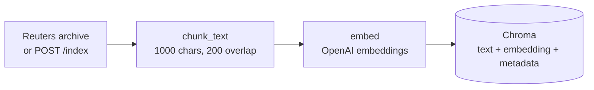
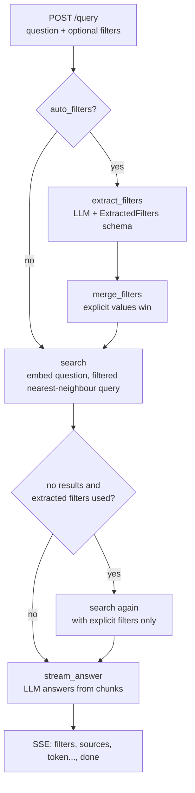

# Architecture

This document explains how the RAG backend answers a question, what each component does, and why it is built the way it is. It assumes basic Python and HTTP knowledge, but no prior experience with RAG or vector databases.

**Contents**

1. [The approach in one paragraph](#1-the-approach-in-one-paragraph)
2. [Key concepts](#2-key-concepts)
3. [Two flows: indexing and querying](#3-two-flows-indexing-and-querying)
4. [Components](#4-components)
   - [config.py](#configpy--settings) · [schemas.py](#schemaspy--data-models) · [topics.py](#topicspy--topic-catalogue) · [services/vector.py](#servicesvectorpy--chunking-embedding-storage-search) · [services/filters.py](#servicesfilterspy--filter-extraction) · [services/llm.py](#servicesllmpy--answer-generation) · [main.py](#mainpy--http-endpoints) · [scripts/ingest_reuters.py](#scriptsingest_reuterspy--corpus-import)
5. [Walkthrough: one question, end to end](#5-walkthrough-one-question-end-to-end)
6. [Design decisions](#6-design-decisions)
7. [Known limitations](#7-known-limitations)

---

## 1. The approach in one paragraph

An LLM on its own knows nothing about our documents. **Retrieval-Augmented Generation (RAG)** fixes that in two steps: first *retrieve* the few passages from our corpus most relevant to the question, then *generate* an answer by giving the LLM the question together with those passages and telling it to answer only from them. Retrieval is done by similarity search over embeddings. Because similarity search cannot reliably honour hard constraints like 'on October 19' or 'only takeover news', this project adds a third step in front: an LLM first **extracts structured filters** (date range, topic) from the question, and the database applies them before ranking by similarity.

```
question ──► extract filters ──► filtered similarity search ──► answer from retrieved passages
              (LLM, Pydantic)      (Chroma, embeddings)            (LLM, streamed)
```

## 2. Key concepts

| Term | Meaning in this project |
|---|---|
| **Corpus** | The documents we can answer from: 19,043 Reuters business news articles from 1987-02-26 to 1987-10-20 (Reuters-21578), plus anything posted to `/index`. |
| **Chunk** | A piece of a document, at most 1,000 characters, overlapping the previous piece by 200 characters. We search and cite chunks, not whole articles, so the passages handed to the LLM stay short and focused. Most articles fit in one chunk; the full corpus gives 28,261 chunks. |
| **Embedding** | A list of 1,536 numbers produced by OpenAI's `text-embedding-3-small` that represents what a text is *about*. Texts with similar meaning get similar numbers. |
| **Vector database** | Chroma, stored on disk in `data/chroma/`. It keeps each chunk's text, embedding and metadata, and finds the chunks whose embeddings are closest to a query embedding. |
| **Distance** | How far apart two embeddings are. We use cosine distance: `0` = same direction (very similar), larger = less similar. Returned with every retrieved chunk. |
| **Metadata** | Structured fields stored next to each chunk, e.g. `date_int: 19871019`, `topics: ["crude", "ship"]`. Unlike the embedding, metadata supports exact filtering. |
| **Filter** (`where` clause) | A condition on metadata that Chroma applies *before* ranking, e.g. 'only chunks with `date_int` between 19871019 and 19871020'. |
| **Topic code** | Reuters' own category labels on each article, such as `crude` (crude oil), `acq` (mergers/acquisitions) or `earn` (earnings). 119 different codes occur in the corpus. |
| **Structured outputs** | An OpenAI feature that forces the LLM's reply to match a JSON schema exactly. We generate that schema from a Pydantic model. |
| **SSE** (Server-Sent Events) | A simple HTTP streaming format: the server sends `event: <name>` / `data: <json>` blocks as they become available, so the client sees the answer appear token by token. |

## 3. Two flows: indexing and querying

### Indexing (write path)



Indexing happens rarely: once for the Reuters corpus via the ingest script, and whenever a client posts a document to `/index`. It costs embedding calls (about $0.10 for the whole corpus).

### Querying (read path)



A query costs one small LLM call for extraction, one embedding call for the question, and one LLM call for the answer.

## 4. Components

```
app/
├── main.py            HTTP endpoints, orchestrates the query flow
├── config.py          Settings from .env
├── schemas.py         Pydantic models for requests, responses, filters
├── topics.py          Catalogue of Reuters topic codes
└── services/
    ├── vector.py      Chunking, embeddings, Chroma storage and search
    ├── filters.py     LLM-based filter extraction and merging
    ├── retrieval.py   Extraction + filtered search + fallback, shared by /query and the evals
    └── llm.py         Prompting and streaming the answer
scripts/
└── ingest_reuters.py  Downloads, parses and indexes Reuters-21578
evals/
├── generate.py        Drafts golden-dataset cases from corpus articles
├── evaluate.py        Scores retrieval against the golden dataset
└── golden.jsonl       The golden dataset
```

The dependency direction is one-way: `main` → `services` → `schemas`/`config`/`topics`. Services never import `main`, and `schemas` imports nothing from the app. `evals` uses the services like `main` does, and nothing in `app` imports `evals`.

### config.py — settings

`Settings` is a `pydantic-settings` class. Each field is read from an environment variable of the same name (case-insensitive) or from `.env`; unknown variables in `.env` are ignored. `get_settings()` is cached, so the file is read once per process.

| Setting | Default | Used for |
|---|---|---|
| `OPENAI_API_KEY` | — (required) | All OpenAI calls |
| `CHAT_MODEL` | `gpt-4o-mini` | Writing the answer |
| `FILTER_MODEL` | `gpt-5.4-nano` | Extracting filters from the question |
| `EMBEDDING_MODEL` | `text-embedding-3-small` | Embedding chunks and questions |
| `CHROMA_PATH` | `data/chroma` | Where the vector database lives on disk |
| `COLLECTION_NAME` | `documents` | Chroma collection holding all chunks |
| `CHUNK_SIZE` / `CHUNK_OVERLAP` | `1000` / `200` | Chunking, in characters |
| `TOP_K` | `4` | Chunks retrieved per question, unless the request sets `top_k` |

> Changing `EMBEDDING_MODEL`, `CHUNK_SIZE` or `CHUNK_OVERLAP` after indexing requires a full re-index: stored embeddings and chunk ids would no longer match.

### schemas.py — data models

All request and response shapes are Pydantic models. FastAPI uses them to validate incoming JSON (invalid input gets a `422` response with details) and to generate the interactive docs at `/docs`.

```
SearchFilters                 date_from, date_to, topic
 └── QueryInput (extends it)  + question, top_k, auto_filters
DocumentInput                 content, metadata
IndexResponse                 status, document_id, message
RetrievedChunk                text, metadata, distance
```

**`MetadataValue`** — `str | int | float | bool | list[str]`. Chroma only accepts flat metadata: scalars, or non-empty lists of them. Nested dicts are rejected at the API boundary rather than failing later in the database.

**`SearchFilters`** — the filters the search understands. All fields are optional; an empty `SearchFilters()` means 'no restriction'.

| Field | Type | Meaning |
|---|---|---|
| `date_from` | `date \| None` | Earliest article date, inclusive. JSON format `YYYY-MM-DD`. |
| `date_to` | `date \| None` | Latest article date, inclusive. |
| `topic` | `str \| None` | One Reuters topic code, e.g. `crude`. Case-insensitive. |

A `model_validator` rejects `date_from` later than `date_to`. Because the type is `date`, values like `"Oct 19"` are rejected too — the API only accepts unambiguous ISO dates; turning free text into dates is the extraction step's job.

**`QueryInput`** — the body of `POST /query`. It *inherits* from `SearchFilters`, so the filter fields sit at the top level of the request next to the question:

| Field | Type | Default | Meaning |
|---|---|---|---|
| `question` | `str` | — (required, non-empty) | The user's question |
| `top_k` | `int \| None` | `None` → `TOP_K` setting | Chunks to retrieve, 1–20 |
| `auto_filters` | `bool` | `true` | Extract missing filters from the question |
| `date_from`, `date_to`, `topic` | | `None` | Explicit filters (see above) |

**`RetrievedChunk`** — one search hit: the chunk `text`, its `metadata` (title, date, topics, …) and its cosine `distance` to the question. These are sent to the client in the `sources` event and numbered `[1]`, `[2]`, … in the LLM prompt.

**`DocumentInput` / `IndexResponse`** — body and response of `POST /index`. The server assigns a random `document_id` (UUID) and returns it immediately with status `202 Accepted`; the actual indexing runs in the background.

### topics.py — topic catalogue

A single dictionary, `TOPICS`, mapping each of the 119 topic codes that occur in the corpus to a readable description:

```python
TOPICS = {
    "acq": "Mergers/Acquisitions",
    "earn": "Earnings and Earnings Forecasts",
    "crude": "Crude Oil",
    "money-fx": "Money/Foreign Exchange",
    ...
}
```

It was generated from `cat-descriptions_120396.txt` in the corpus archive. That file lists 135 codes, but 16 never appear on an article; they are left out so the extraction step cannot choose a topic that matches nothing. Commodity codes are listed without names in the source file, so readable names were added by hand (`alum` → Aluminium, `l-cattle` → Live Cattle).

`TOPICS` serves two purposes in `filters.py`:

1. **The list of allowed values** — it becomes the `enum` in the JSON schema, so the LLM can only output one of these 119 codes (or `null`).
2. **Context for the LLM** — the code/description pairs are written into the system prompt, so the model knows that 'oil prices' means `crude` and 'takeover' means `acq`.

Explicit `topic` values in a request are *not* checked against `TOPICS`; an unknown code simply matches no chunks.

### services/vector.py — chunking, embedding, storage, search

Everything that touches Chroma or the embedding API.

**`chunk_text(text, chunk_size, overlap)`** — splits text into windows of at most `chunk_size` characters. Each new window starts `overlap` characters before the previous one ended, so a sentence cut at a boundary still appears whole in one of the two chunks. Cuts are moved back to the nearest space so words are not split. Text shorter than `chunk_size` stays a single chunk. The function is deterministic: the same text always gives the same chunks — `update_metadata` relies on that.

**`embed(texts)`** — one OpenAI embeddings request for a list of texts; returns one vector per text.

**`add_documents([(document_id, content, metadata), ...])`** — the write path. For each document: chunk it, give each chunk the id `"{document_id}:{chunk_number}"`, and add `document_id` and `chunk` to its metadata. All chunks of all documents go into **one** embedding call, then one Chroma `upsert`. Upsert means 'insert, or overwrite if the id exists', which makes re-running an import safe. `add_document` is the single-document shortcut used by `/index`.

**`update_metadata(documents)`** — rewrites metadata without re-embedding (free). It recomputes chunk ids the same way as `add_documents` and calls Chroma's `update`. Chroma *merges* metadata on update, so to remove a key you must set it to `None` explicitly.

**`document_metadata(document_ids)`** — the metadata of each indexed document, read from its first chunk; unknown ids are left out. The evaluation uses it to check which golden articles are indexed and whether the applied filters admit them.

**`build_filter(filters)`** — translates `SearchFilters` into Chroma's filter syntax:

| Filter | Chroma condition |
|---|---|
| `date_from = 1987-10-19` | `{"date_int": {"$gte": 19871019}}` |
| `date_to = 1987-10-20` | `{"date_int": {"$lte": 19871020}}` |
| `topic = "crude"` | `{"topics": {"$contains": "crude"}}` |

Several conditions are combined with `{"$and": [...]}`; no conditions gives `None` (no filter). Dates are compared as integers because Chroma's `$gte`/`$lte` only work on numbers, and `YYYYMMDD` integers sort in date order. `$contains` on a list field checks list membership: `tin` matches `["tin", "zinc"]` but not `["platinum"]`.

**`search(query, top_k, filters)`** — the read path: embed the question, ask Chroma for the `top_k` nearest chunks *among those that pass the filter*, and wrap them as `RetrievedChunk` objects, closest first.

**Chunk metadata** for a Reuters article:

| Key | Example | Notes |
|---|---|---|
| `source` | `"reuters-21578"` | |
| `reuters_id` | `21131` | The corpus' `NEWID` |
| `document_id` | `"reuters-21131"` | Stable id, makes re-imports overwrite instead of duplicate |
| `chunk` | `0` | Position within the article (this one has 4 chunks, `0`–`3`) |
| `title` | `"AMPLE SUPPLIES LIMIT U.S. STRIKE'S OIL PRICE IMPACT"` | Same on every chunk of the article |
| `date` | `"1987-10-19"` | Human-readable |
| `date_int` | `19871019` | For range filters |
| `topics` | `["crude"]` | Omitted when the article has none (Chroma rejects empty lists) |
| `places` | `["uk", "usa", "iran", "kuwait", "saudi-arabia"]` | Omitted when empty |

### services/filters.py — filter extraction

Turns a free-text question into `SearchFilters`, and combines them with any filters the client sent explicitly.

**`ExtractedFilters`** — the Pydantic model the LLM must fill in. It is passed to OpenAI as `response_format`; the SDK converts it to a strict JSON schema, and OpenAI's structured outputs guarantee the reply matches it. The SDK then parses the reply back into an `ExtractedFilters` instance with real `date` objects.

| Field | Type | Purpose |
|---|---|---|
| `date_from` | `date \| None` | First day the question refers to |
| `date_to` | `date \| None` | Last day the question refers to |
| `subject` | `str` | The question's subject in a few plain words |
| `topic` | one of the 119 codes, or `None` | Best matching topic |

Strict mode requires every field to be present, so 'not mentioned' is expressed as `null` rather than a missing field. The field *order* matters: the model generates fields in order, and `subject` comes before `topic` on purpose (see [design decisions](#llm-picks-a-topic-from-a-fixed-list)). `subject` is not used afterwards.

**`SYSTEM_PROMPT`** — tells the model what the archive covers (dates from Feb to Oct 1987), the date rules (a day → that day; a month → first to last day; early/mid/late → days 1–10/11–20/21–end; no year → 1987; vague references like 'recently' → null), the topic rules with examples of mapping by meaning ('OPEC' → `crude`), and the full topic list.

**`extract_filters(question)`** → `ExtractedFilters | None` — one call to `FILTER_MODEL` via `client.chat.completions.parse(...)`. Any failure (network, API error, refusal) is logged and returns `None`, so a broken extraction never breaks the query — it just runs unfiltered.

**`merge_filters(explicit, extracted)`** → `SearchFilters` — decides which filters are actually applied:

1. **Explicit values win.** A filter field the client set is never replaced by an extracted one.
2. **Dates are taken as a pair.** If the client set `date_from` *or* `date_to`, both extracted dates are ignored, to avoid mixing the client's start with the LLM's end.
3. **Single days are widened.** If the extracted range is exactly one day, `date_to` gets one extra day, because news about an event often appears the next day. (Explicit dates are never widened.)
4. **Invalid combinations are dropped.** If the result would fail `SearchFilters` validation (e.g. the LLM returned a start after the end), only the explicit dates are kept; the topic still applies.

Examples (extraction result: October 19–19, `crude`):

| Request fields | Applied filters | Rule |
|---|---|---|
| — | Oct 19–20, `crude` | 3 |
| `topic: "acq"` | Oct 19–20, `acq` | 1 |
| `date_from: 1987-03-01` | from Mar 1 (no end), `crude` | 1, 2 |
| `auto_filters: false` | nothing | extraction skipped |

The two override cases as full requests:

**Explicit topic overrides the extracted topic.**

```json
POST /query
{"question": "What happened to oil prices on October 19, 1987?", "topic": "acq"}
```

The LLM extracts Oct 19–19 and `crude`. Applied: **Oct 19–20, `acq`**. The client's topic replaces `crude`; the extracted dates are kept (and widened), because the client set no dates.

**One explicit date discards both extracted dates.**

```json
POST /query
{"question": "What happened to oil prices on October 19, 1987?", "date_from": "1987-03-01"}
```

The LLM extracts Oct 19–19 and `crude` again. Applied: **from Mar 1 with no end date, `crude`**. Because the client set a date bound, both extracted dates are dropped. Keeping the extracted `date_to` would give Mar 1 – Oct 20 — a range neither the client nor the question asked for. And if the client had set `date_from: 1987-10-25`, mixing it with the extracted end would give a start *after* the end. The extracted topic still applies, since the client set none.

In both cases the request contradicts the question, and the request wins silently: there is no warning. The `filters` event at the start of the response shows what was actually applied, so a client can display it, e.g. 'Searching: from 1 March 1987 · Crude Oil'.

### services/llm.py — answer generation

**`SYSTEM_PROMPT`** — instructs the model to answer only from the provided context, to say so if the context does not contain the answer, and to cite passages as `[1]`, `[2]`, ….

**`build_context(chunks)`** — numbers the retrieved chunks, `[1] <text>`, `[2] <text>`, …, in the same order as the `sources` event, so a citation `[2]` in the answer refers to the second source the client received.

**`stream_answer(question, chunks, filters)`** — an async generator that produces the SSE stream:

| Order | Event | Data |
|---|---|---|
| 1 | `filters` | The applied `SearchFilters`, e.g. `{"date_from": "1987-10-19", "date_to": "1987-10-20", "topic": "crude"}` |
| 2 | `sources` | List of `RetrievedChunk` (text, metadata, distance) |
| 3…n | `token` | A piece of the answer text |
| last | `done` | `null` |

Every `data` payload is JSON-encoded, including tokens. A raw newline inside a token would otherwise end the SSE block early and corrupt the stream.

### main.py — HTTP endpoints

| Endpoint | What it does |
|---|---|
| `GET /health` | Returns `{"status": "ok"}`. |
| `POST /index` | Validates a `DocumentInput`, assigns a `document_id`, schedules `add_document` as a FastAPI background task and returns `202` immediately. Errors during indexing are logged, since the client is already gone. |
| `POST /query` | Orchestrates the query flow below and returns a `StreamingResponse`. |

`query_rag` step by step:

1. `top_k` = request value or the `TOP_K` setting.
2. `explicit` = the filter fields copied out of the request into a plain `SearchFilters`.
3. `applied, chunks = retrieval.retrieve(question, top_k, explicit, auto_filters)`, which does steps 3a–3c:
   1. If `auto_filters`: `applied = merge_filters(explicit, await extract_filters(question))`; otherwise `applied = explicit`.
   2. `chunks = search(question, top_k, applied)`.
   3. **Fallback:** if no chunks were found *and* extracted filters were involved (`applied != explicit`), search again with `explicit` only. Extracted filters can be too narrow — e.g. a date outside the corpus — and an answer from unfiltered results is better than none.
4. Return `stream_answer(question, chunks, applied)` as `text/event-stream`.

The retrieval steps live in `services/retrieval.py` rather than in the endpoint so the evaluation scripts run exactly the same pipeline. Chroma and the embedding client are synchronous, so `search` runs via `asyncio.to_thread` to avoid blocking the async event loop while it waits on the network or disk.

### scripts/ingest_reuters.py — corpus import

Run as `python -m scripts.ingest_reuters [--limit N] [--batch-size N] [--dry-run] [--metadata-only]`.

1. **Download** the original archive from the UCI repository into `data/reuters21578/` on first run.
2. **Parse** the 22 `.sgm` files directly from the `.tar.gz` (no extraction to disk). Each `<REUTERS NEWID="…">` block becomes one article; title, date, body, topics and places are read with regular expressions. Articles without a body (about 2,500 headline-only items) are skipped.
3. **Build the document text** as `title`, `date`, blank line, `body`, with Reuters' trailing 'Reuter' sign-off removed. Putting title and date into the text means they are also part of the embedding.
4. **Index in batches** of 100 articles per `add_documents` call.

`--metadata-only` re-parses the archive and calls `update_metadata` instead of `add_documents`: metadata is rewritten, embeddings are kept, nothing is paid. It was used to migrate `topics`/`places` from comma-separated strings to lists. It sets `topics` and `places` to `None` before merging, so leftovers from the old format are deleted for articles that have no labels.

## 5. Walkthrough: one question, end to end

Request:

```json
POST /query
{"question": "What happened to oil prices on October 19, 1987?"}
```

1. **Validation.** FastAPI parses the body into `QueryInput`: `auto_filters = true`, no explicit filters, `top_k = 4` from settings.
2. **Extraction.** `gpt-5.4-nano` returns
   `{"date_from": "1987-10-19", "date_to": "1987-10-19", "subject": "oil prices on October 19, 1987", "topic": "crude"}`.
3. **Merge.** No explicit filters, so the extracted ones apply; the single day is widened → Oct 19–20, `crude`.
4. **Filter.** `build_filter` gives
   `{"$and": [{"date_int": {"$gte": 19871019}}, {"date_int": {"$lte": 19871020}}, {"topics": {"$contains": "crude"}}]}`.
   Of 28,261 chunks, only oil articles from those two days remain as candidates.
5. **Search.** The question is embedded; Chroma returns the 4 closest candidates:
   - 'AMPLE SUPPLIES LIMIT U.S. STRIKE'S OIL PRICE IMPACT' (Oct 19)
   - 'UNOCAL RAISES CRUDE OIL POSTED PRICES' (Oct 19)
   - 'TEXACO UNIT RAISES CRUDE OIL PRICES' (Oct 20)
   - 'EX-ARCO CHIEF SEES ENERGY CRISIS BY 1990' (Oct 19)
6. **Answer.** The chunks are numbered `[1]`–`[4]` in the prompt and the answer streams back:
   > On October 19, 1987, oil prices initially rose following the U.S. strike on an Iranian oil platform but then fell due to ample supplies of OPEC crude, which limited and reversed the price gains. … [1]

**Without extraction** (`auto_filters: false`), the same question retrieved chunks from March 6, October 19, April 7 and March 5: similarity search found articles *about oil prices*, but the date in the question barely influenced the ranking. The answer was still right only because one relevant article happened to rank second.

## 6. Design decisions

### Why extract filters instead of relying on similarity alone
An embedding represents the overall meaning of a text. 'October 19, 1987' shifts it slightly but does not act as a constraint, and the corpus has 566 crude-oil articles spread over eight months. Exact values — dates, categories, names, numbers — are what metadata filters are for. The LLM's job is only to translate language into those fields; the database applies them exactly.

### Why Pydantic for the extraction
Pydantic defines the shape once and gives three things from it: the JSON schema sent to OpenAI (so the model *must* answer in that shape), parsing of the reply into typed Python values (`date`, not `"Oct 19"`), and validation (a topic outside the list cannot occur). Malformed output fails loudly instead of silently producing a broken filter.

### LLM picks a topic from a fixed list
With structured outputs, the `topic` field is constrained to the 119 codes. This prevents invented codes, but has a trap found in testing: `gpt-4o-mini` mapped 'OPEC' to `oilseed`. Without the constraint it wanted to write `"opec"` or `"oil output"` — not valid codes — and constrained decoding completed the word to the nearest code that fitted. A *wrong* topic is worse than none: oilseed articles exist, so the empty-result fallback never triggers. Two measures:
- **The `subject` field before `topic`** lets the model state the subject in its own words before committing to a code.
- **A newer model.** All `gpt-5.4` models tested got all 10 test questions right, including OPEC. `gpt-5.4-nano` was the fastest (0.9 s for 10 parallel calls) and is the default.

### Why explicit filters win
A field in the request is a deliberate choice, typically from a UI control. An extracted filter is the LLM's interpretation of text. When they disagree, the deliberate choice wins; the `filters` event shows the client what was actually used.

### Why widen single extracted days
News about an event often runs the day after it. For October 19, 1987, there are 588 articles dated the 19th and 655 dated the 20th. Explicit dates are left as given, since the client may mean exactly that day.

### Why `date_int` alongside `date`
Chroma's range operators only work on numbers. `YYYYMMDD` integers compare correctly (`19870301 < 19871019`) and remain readable.

### Why topics are lists, not strings
A list allows exact membership checks with `$contains`. With a comma-separated string, filtering would need substring matching, and 8 codes in the corpus are contained in other codes (11 pairs in total): `tin` would match `platinum`, `heat` (heating oil) would match `wheat`, `gas` would match `nat-gas`.

### Why stable document ids for the corpus
`reuters-{NEWID}` instead of random ids means re-running the import overwrites existing chunks instead of duplicating them, and `--metadata-only` can find exactly the chunks to update.

## 7. Known limitations

- **Documents from `/index` have no `date_int` or `topics`.** Any date or topic filter excludes them. With `auto_filters` on, a question that mentions a date will therefore skip them, unless the filtered search returns nothing and the fallback kicks in.
- **The fallback only triggers on zero results.** If extracted filters are wrong but still match something, the wrong results are used. The `filters` event makes this visible to the client. The evaluation measured the effect: a wrong topic is the main source of retrieval misses ([evaluation.md](evaluation.md#6-findings)).
- **One topic per question.** 'Oil and gold prices' can only be filtered by one of the two; the extraction picks one, or none.
- **The extraction prompt is corpus-specific.** Date range, topic list and examples are written for Reuters-21578. A different corpus needs its own `topics.py` and prompt.
- **Similarity search ranks by meaning, not by importance.** Within the filtered candidates, the 'closest' chunks are not necessarily the most informative.
- **Extra latency and cost per query.** Extraction adds one LLM call (about a second) before the search can start.
